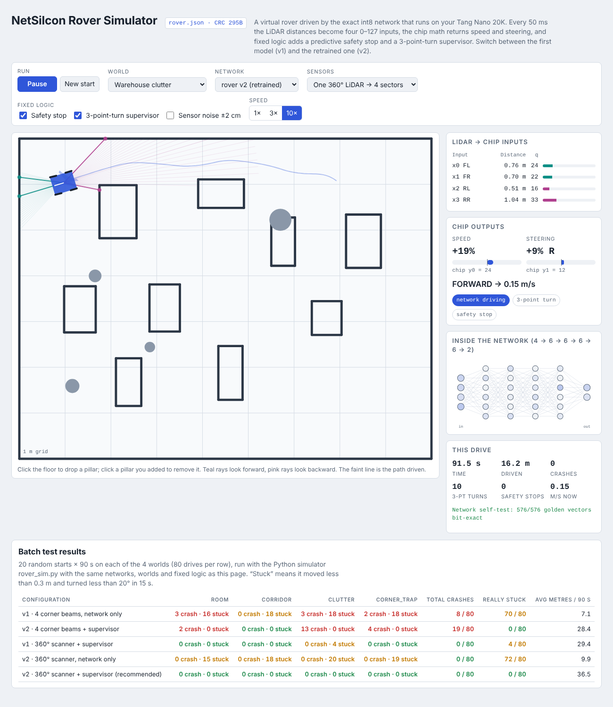
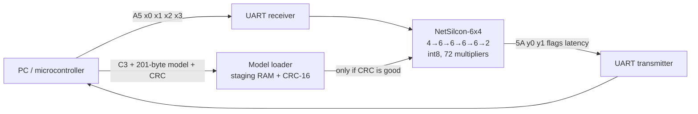

# NetSilcon-6x4

**One fixed neural-network shape in hardware. Load new numbers and it does a new job.**

> Part of the [NetSilcon](../../README.md) family. Larger model: [NetSilcon-64x6](../NetSilcon-64x6/).

NetSilcon-6x4 is a small neural-network inference engine for edge devices, prototyped
on a **Sipeed Tang Nano 20K** FPGA (Gowin GW2AR-18). The network shape
**4 → 6 → 6 → 6 → 6 → 2** is built into the logic. All 170 weights and biases and
the 5 layer scaling shifts are loadable at run time over UART, with a CRC check. The
same bitstream has run three different applications, each one a 201-byte model
uploaded in about 31 ms.

> **Status:** working FPGA prototype, verified on real hardware. It is not a fabricated
> chip. The architecture is written so it could later become one (see [Roadmap](#roadmap)).



More: [preliminary datasheet (PDF)](docs/NetSilcon-6x4_Datasheet.pdf) · [simulation waveform](docs/images/netsilcon_waveform.png) · [demo video](../../media/NetSilcon_Demo.mp4) · [keynote video](../../media/NetSilcon_Keynote.mp4)

---

## Measured results

Measured on a Tang Nano 20K at 27 MHz unless stated otherwise. The raw logs are in
[`results/logs/`](results/logs/).

| What | Result |
|---|---|
| Inference latency on the chip | **15 clocks = 0.56 µs** at 27 MHz |
| Throughput | one inference every 2 clocks (13.5 million per second at 27 MHz) |
| Hardware vs Python int8 model | **bit-exact**: 576 / 576 golden vectors for each of the 3 apps |
| Model upload over UART | 204 bytes, about 31 ms including USB. The swap inside the FPGA takes 7.4 µs |
| Corrupted upload (one CRC bit wrong) | **refused**, and the old model keeps running |
| Hardware-in-the-loop: the real FPGA drives a simulated rover | 9,600 real-time decisions, **0 mismatches, 0 crashes**, also with ±2 cm sensor noise |
| FPGA resources (Gowin EDA) | 49 % logic, 22 % registers, 24/24 DSP blocks, 1 block RAM |
| Timing (Gowin EDA) | 29.1 MHz achievable vs 27 MHz required, PASS |

## Three jobs, one bitstream

| Model file | Inputs | Outputs | Int8 accuracy |
|---|---|---|---|
| [`models/motor_fault/`](models/motor_fault/) (built into the bitstream) | current, voltage, speed, temperature | HEALTHY / FAULT | 94.5 % |
| [`models/irrigation/`](models/irrigation/) | soil moisture, air temperature, humidity, sunlight | SKIP / WATER | 97.4 % |
| [`models/rover/`](models/rover/) (v2) | 4 LiDAR sector distances | speed, steering (continuous) | 91.5 % action agreement* |

\* The rover model is judged in closed loop, in the simulator, not by accuracy alone.
v2 copies its training rules less exactly than v1 (95.5 %) but drives better: 0 crashes
and 0 stuck runs in 80 simulated drives (see [rover simulator](#rover-simulator-and-hardware-in-the-loop)).

---

## How it works



**The math in every neuron** is identical in Verilog ([`fpga/rtl/nn_layer.v`](fpga/rtl/nn_layer.v))
and Python ([`python/host/netsilcon_host.py`](python/host/netsilcon_host.py)):

```
acc = bias16 + Σ x_i · w_i          int8 inputs × int8 weights, 20-bit signed accumulator
hidden layers: acc = max(acc, 0)    ReLU = check the sign bit
y = (acc + 2^(s−1)) >>> s           round, then shift by the layer's shift s (loadable, 0..15)
y = clamp to 0..127 (hidden)  or  −128..127 (output)
```

**Fitting a small FPGA.** A fully parallel network needs 144 multipliers, and the
GW2AR-18 has 96. With `PHASES = 2`, each neuron uses half its multipliers twice, so the
design needs 72 and produces one result every 2 clocks. Both modes give bit-identical
results. Each layer also registers its sum before the activation step. That keeps the
slowest path short enough to meet timing with run-time shifts.

**Safe model updates.** An uploaded model first goes into a staging block RAM, which plays
the role the flash would have in a real chip. It is copied into the network only when its
CRC-16 is correct. A damaged or interrupted upload is refused, and the running model
continues. Details: [`docs/architecture.md`](docs/architecture.md),
[`docs/protocol.md`](docs/protocol.md).

---

## Quick start

### 1. Simulate (no board needed)

You need Python 3 with numpy, and [Icarus Verilog](https://steveicarus.github.io/iverilog/).

```bash
bash fpga/scripts/run_all_tests.sh   # network vs Python, live UART, model upload
# Windows without bash:  fpga\scripts\run_sim.bat
```

Every test ends with `RESULT: PASS`.

### 2. Build and load on the Tang Nano 20K

**Gowin EDA (Education edition)**

1. New project, device **GW2AR-LV18QN88C8/I7**.
2. Add `fpga/rtl/*.v`, `fpga/board/ns_uart.v`, `fpga/board/ns_loader.v`, `fpga/board/tangnano20k_uart.v`,
   `fpga/board/tangnano20k_uart.cst` and `fpga/board/tangnano20k.sdc`. Set the top module to
   `tangnano20k_uart`, add `fpga/gen/` to the include path, and copy `fpga/gen/*.mem` into the
   project folder.
3. Synthesize, then Place & Route. Program with **SRAM Program**: cable *USB Debugger A*,
   0.9 MHz, device GW2AR-18C.

**Open-source flow**

```bash
pip install yowasp-yosys yowasp-nextpnr-himbaechel-gowin apycula
bash fpga/scripts/build_opensource.sh uart     # → fpga/build/netsilcon_uart.fs
openFPGALoader -b tangnano20k fpga/build/netsilcon_uart.fs
```

`bash fpga/scripts/build_opensource.sh selftest` builds a stand-alone self-test instead. It runs
all golden vectors on the board and shows PASS or FAIL on the LEDs and the serial port.

### 3. Talk to it from the PC

```bash
pip install pyserial
cd python/host
python netsilcon_host.py COM7 --info                                   # which model is running?
python netsilcon_host.py COM7 --values 10 24 3500 65                   # one reading in real units
python netsilcon_host.py COM7 --load ../../models/irrigation/irrigation.json --corrupt   # must be REFUSED
python netsilcon_host.py COM7 --load ../../models/irrigation/irrigation.json         # give it a new job
python netsilcon_host.py COM7 --demo                                   # the model's demo scenarios
python netsilcon_host.py COM7 --test                                   # 576 vectors, bit-exact check
```

Every run writes a `.log` and a `.csv` file to `results/logs/host/` (not committed; curated examples are in `results/logs/`).

---

## Make your own model

Any job with 4 inputs and 2 outputs fits. Add an entry to
[`python/model/apps.py`](python/model/apps.py): input names, units and ranges, output labels, a data
generator and demo scenarios. Then:

```bash
cd python/model
python make_model.py <name>          # trains, quantizes to int8 and writes models/<name>/<name>.json
```

The `.json` file holds the weights, biases, shifts, the CRC of the 201-byte image, the
golden test vectors and the demo scenarios. Classifiers use `y1 > y0` as the decision.
Regression models (like the rover) read `y / 127` as a value from −1 to +1.

---

## Rover simulator and hardware in the loop

`python/rover_sim/` holds a 2D simulator of an Ackermann rover with a 360° LiDAR, reduced to 4
corner sectors. The `rover.json` network drives it, wrapped in two small fixed-logic blocks:
a **predictive safety stop** (blocks a move only if the body would touch an obstacle within
0.4 s) and a **3-point-turn supervisor** (steps in when the robot makes no progress, because
the network has no memory of what it just did).

```bash
cd python/rover_sim
python rover_sim.py --sensors scanner --unstick           # 20 random starts × 4 worlds
python rover_sim.py --hil COM7 --map clutter --view       # the REAL FPGA drives, live window
python rover_sim.py --hil COM7 --noise 0.02               # HIL batch with sensor noise
```

`rover_simulator.html` is the same simulator in a browser. It shows the inputs, the chip's
raw outputs and every neuron's activation, and lets you switch between models v1 and v2.

80 simulated drives per setup (20 starts × 4 worlds × 90 s), from
[`results/rover_batch_results.txt`](results/rover_batch_results.txt):

| Setup | Crashes | Stuck | Avg distance |
|---|---|---|---|
| v1 · 4 corner single-beam LiDARs, network only | 8 / 80 | 70 / 80 | 7 m |
| v2 · 4 corner beams + supervisor | 19 / 80 | 0 / 80 | 28 m |
| v1 · 360° scanner + supervisor | 0 / 80 | 4 / 80 | 29 m |
| v2 · 360° scanner, network only | 0 / 80 | 72 / 80 | 10 m |
| **v2 · 360° scanner + supervisor** | **0 / 80** | **0 / 80** | **37 m** |

The lessons: single-beam sensors leave blind spots between the beams, so a pillar
straight ahead goes unseen. A network with no memory needs a small supervisor to get out of
dead ends. Training on the situations the robot actually met in the simulator fixed the rest.

---

## Repository layout

```
models/             motor_fault/, irrigation/, rover/ (v2 + v1)   one folder per application
fpga/
  rtl/              nn_layer.v, netsilcon_top.v           the network (shape fixed, numbers loadable)
  board/            tangnano20k_uart.v                     board top: UART protocol, latency counter, LEDs
                    ns_uart.v, ns_loader.v                 UART RX/TX, model loader with CRC-16
                    tangnano20k_selftest.v                 stand-alone on-board self-test
                    *.cst, *.sdc                           pins and 27 MHz clock constraint
  tb/               testbenches (network, board self-test, UART, model upload)
  gen/              built-in model (motor fault): weights.mem, biases.mem, shifts, golden vectors
  scripts/          run_all_tests.sh, build_opensource.sh, ...  (sim/ and build/ are created here)
python/
  model/            data.py, train.py, quantize.py         built-in model pipeline (numpy only)
                    apps.py, make_model.py                 any app → models/<name>/<name>.json
  host/             netsilcon_host.py                      PC tool: inference, upload, tests, logs
  rover_sim/        rover_sim.py, rover_simulator.html     simulator, batch tests, hardware-in-the-loop
  bench/            same-network CPU and Cortex-M4 benchmark code (see docs/benchmarks.md)
docs/               architecture.md, protocol.md, results.md, benchmarks.md, datasheet, images/
results/            logs/ (curated hardware runs), rover_batch_results.txt
```

## Limitations

- **Not tested with real sensors yet.** The rover results come from simulation and
  hardware-in-the-loop. Real LiDAR noise, reflections and motor behaviour are still untested.
- **Uploaded models live in registers.** At power-off the built-in model comes back.
  Saving models to flash is on the roadmap.
- **The rover's safety stop and supervisor run on the PC** in the simulator for now. They
  are designed to move into the FPGA.
- **The network is deliberately small** (170 parameters). It suits sensor-level decisions,
  not vision or language.

## Roadmap

1. Safety stop + supervisor in FPGA logic beside the network, then HIL of the complete controller
2. Store the uploaded model in flash and load it at power-up with a CRC check
3. Benchmark against a microcontroller (STM32 with CMSIS-NN): cycles and energy
4. ~~A larger engine (16 → 64×6 → 16) with weights streamed from block RAM~~ **done:** see [NetSilcon-64x6](../NetSilcon-64x6/)
5. Long term: tape out on a shared multi-project wafer

## License

[Apache License 2.0](../../LICENSE). Copyright 2026 Nitish Kumar Sharma.
