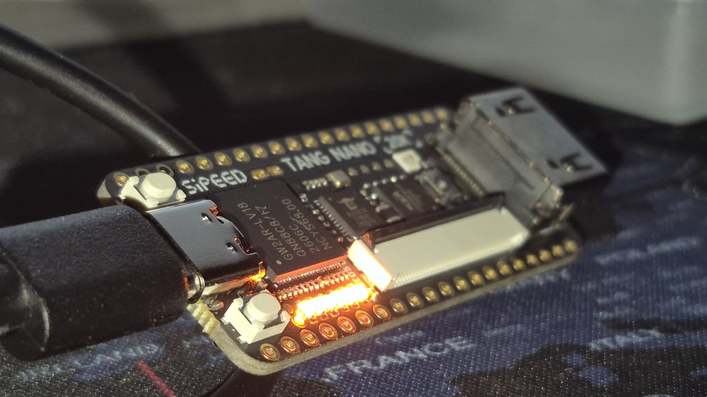
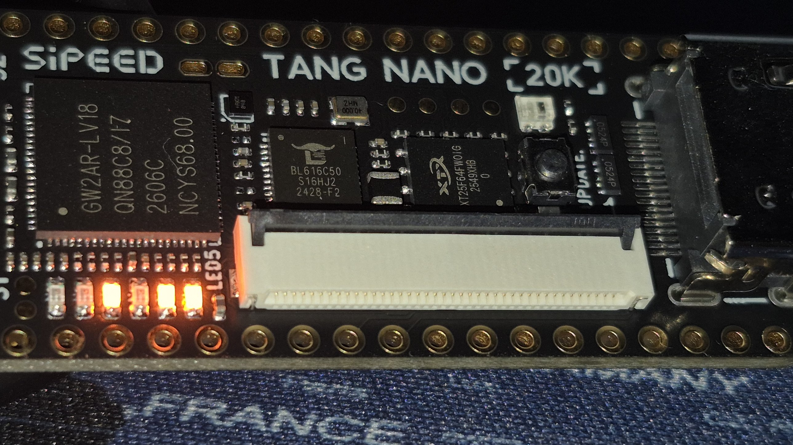
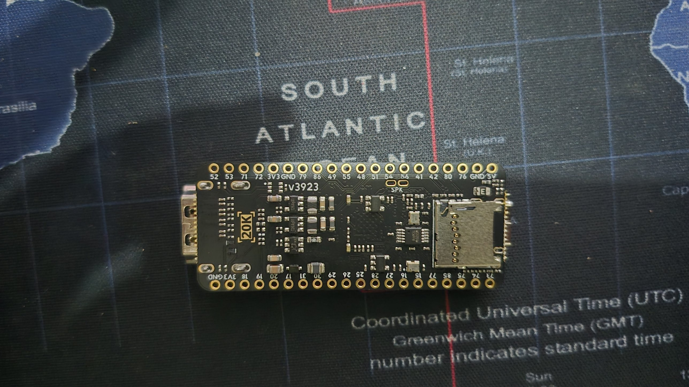
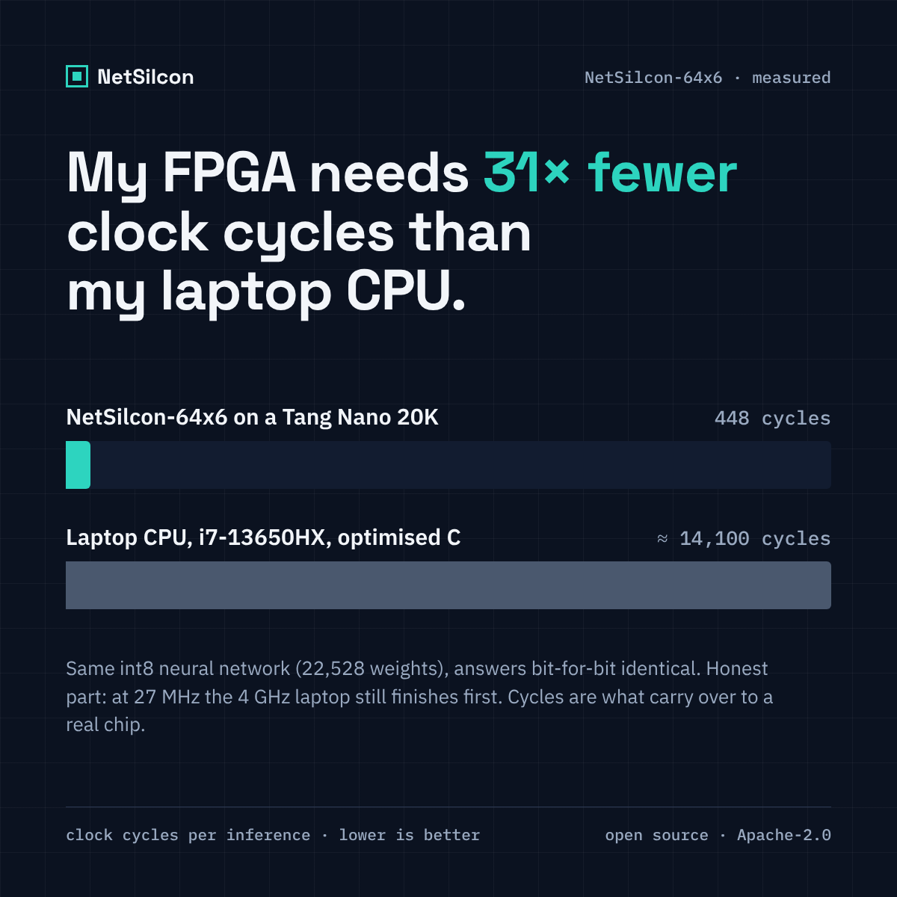
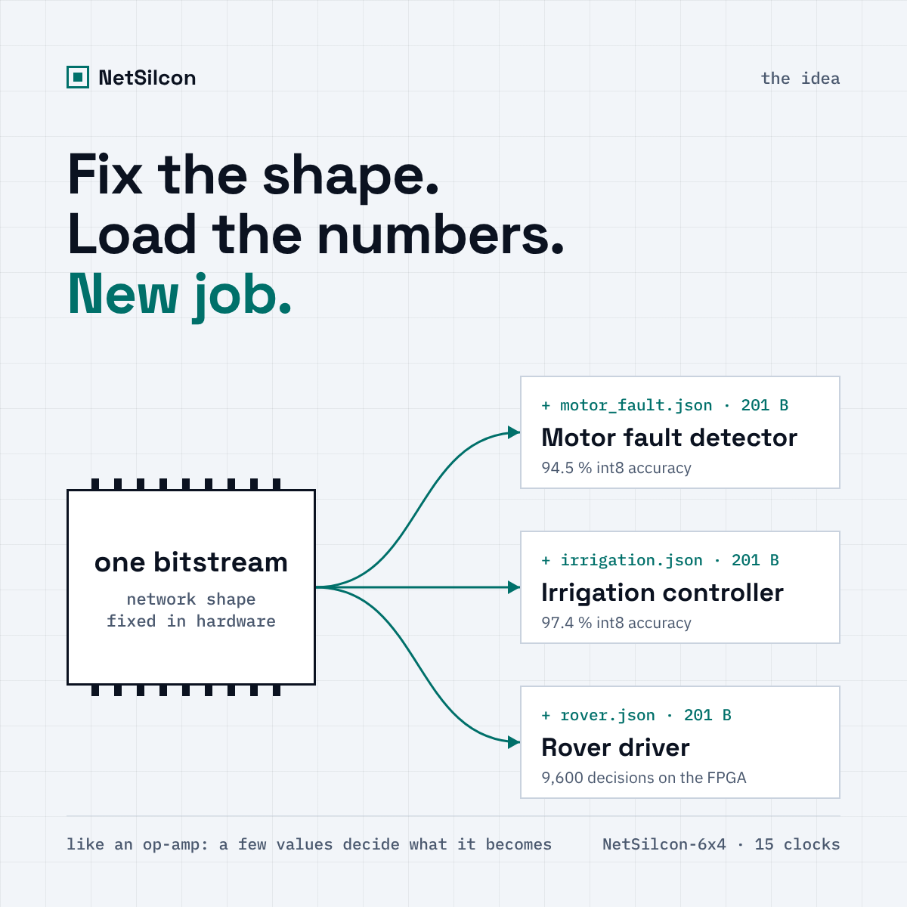
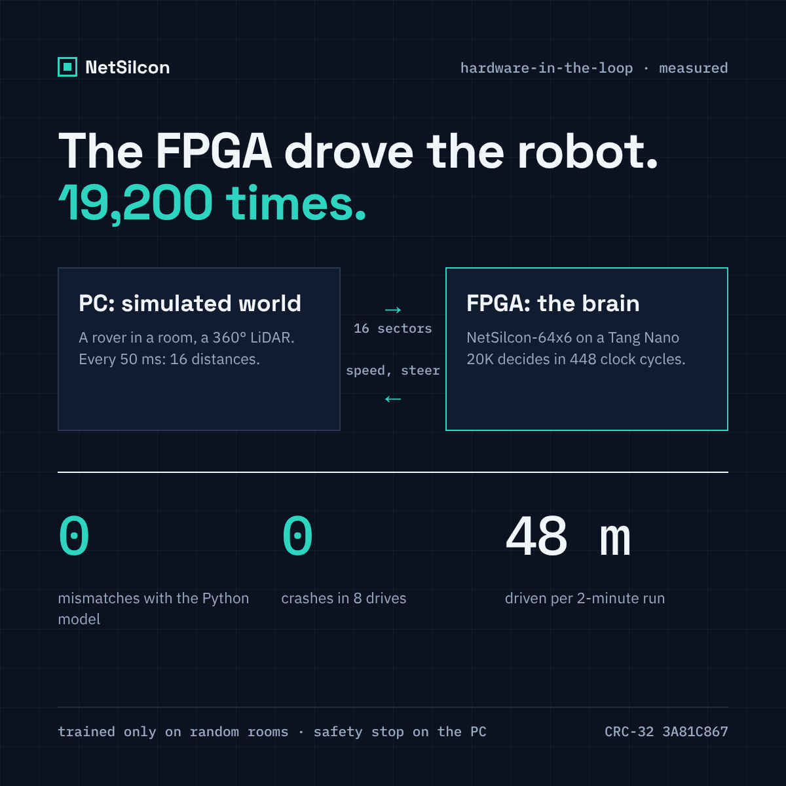
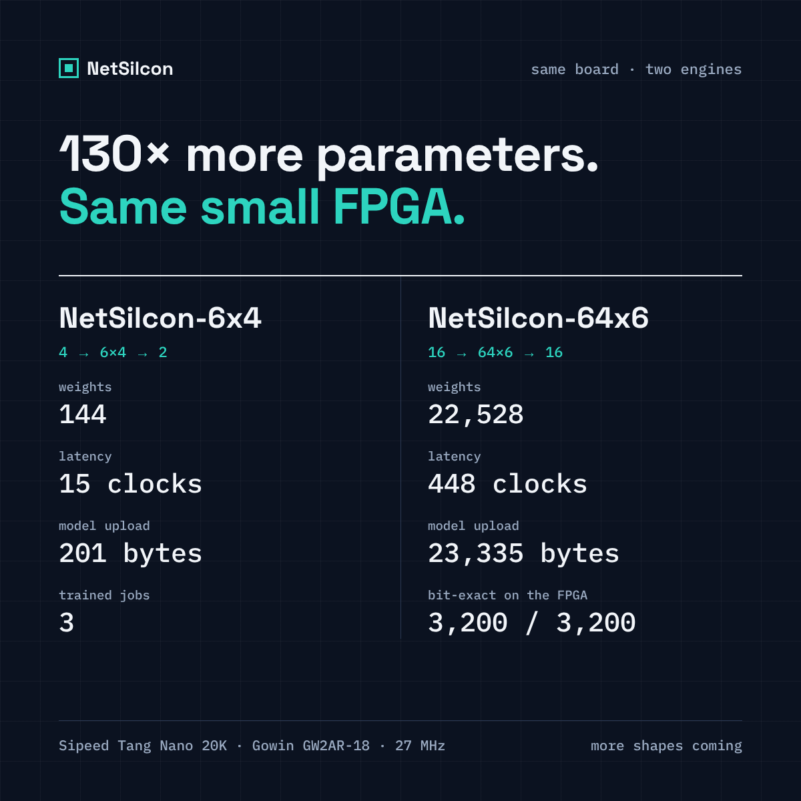
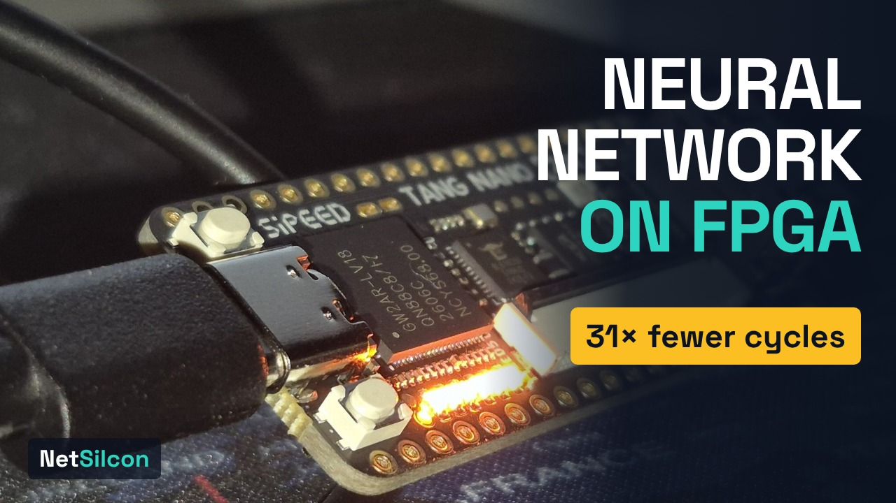
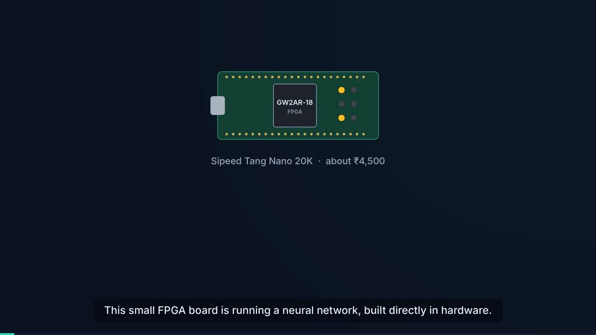

# NetSilcon

**One fixed neural-network shape in hardware. Load new numbers and it does a new job.**

Repository: **NetSilcon-FPGA**, the FPGA prototypes of the NetSilcon engines. Website:
**https://kumarnitish378.github.io/NetSilcon/** (source in the `website/` submodule).

NetSilcon is a family of small neural-network inference engines for edge devices, prototyped on
a **Sipeed Tang Nano 20K** FPGA (Gowin GW2AR-18). In every model the network **shape** is built
into the logic, and everything else (weights, biases, per-layer shifts) is **loadable at run time**
over UART with a CRC check. One bitstream can therefore do many jobs of the same shape: like an
op-amp, which becomes an amplifier, a filter or a comparator depending on a few resistor values.

| | General processor | NetSilcon | Fully hardwired |
|---|---|---|---|
| Network shape | anything | **fixed** | fixed |
| Weights, biases, shifts | anything | **loadable** | fixed |
| Speed | instruction by instruction | dataflow | dataflow |
| Jobs per chip | many | **many** (same shape) | one |

> **Status:** working FPGA prototypes, verified on real hardware. Not a fabricated chip.

<table>
  <tr>
    <td width="33%"></td>
    <td width="33%"></td>
    <td width="33%"></td>
  </tr>
</table>
<p align="center"><sub>The real hardware: our Sipeed Tang Nano 20K (Gowin GW2AR-18). All six photos: <a href="media/photos/">media/photos/</a></sub></p>

<table>
  <tr>
    <td width="50%"></td>
    <td width="50%"></td>
  </tr>
  <tr>
    <td width="50%"></td>
    <td width="50%"></td>
  </tr>
</table>

## Videos and documents

<table>
  <tr>
    <td colspan="2" align="center"><a href="media/youtube/NetSilcon_YouTube.mp4"></a><br><b>Full explainer</b> · 8:49 · how it works, step by step, with the measured numbers (<a href="media/youtube/NetSilcon_YouTube.en.srt">captions</a>)</td>
  </tr>
  <tr>
    <td width="50%" align="center"><a href="media/NetSilcon_Demo.mp4"></a><br><b>Demo</b> · 2:07 · the Tang Nano 20K at work</td>
    <td width="50%" align="center"><a href="media/NetSilcon_Keynote.mp4"></a><br><b>Keynote</b> · 2:05 · the idea and the numbers</td>
  </tr>
</table>

- Datasheets (preliminary, PDF): [NetSilcon-6x4](NetSilcon-Models/NetSilcon-6x4/docs/NetSilcon-6x4_Datasheet.pdf) · [NetSilcon-64x6](NetSilcon-Models/NetSilcon-64x6/docs/NetSilcon-64x6_Datasheet.pdf)
- Test report: [NetSilcon-64x6](NetSilcon-Models/NetSilcon-64x6/docs/test_report.md) · Results: [NetSilcon-6x4](NetSilcon-Models/NetSilcon-6x4/docs/results.md)
- Everything for sharing (images, posts, datasheets): [`media/launch/`](media/launch/)

## Models

| | [NetSilcon-6x4](NetSilcon-Models/NetSilcon-6x4/) | [NetSilcon-64x6](NetSilcon-Models/NetSilcon-64x6/) |
|---|---|---|
| Network | 4 → 6 → 6 → 6 → 6 → 2 | 16 → 64 → 64 → 64 → 64 → 64 → 64 → 16 |
| Parameters (total) | **170**: 144 weights + 26 biases (+ 5 shifts) | **22,928**: 22,528 weights + 400 biases (+ 7 shifts) |
| Model size (upload) | 201 bytes, CRC-16 | 23,335 bytes, CRC-32 |
| Where the weights live | registers | 32 block RAMs, two banks |
| Compute | 72 multipliers, all neurons in parallel | 64 MAC lanes, one input per clock |
| **Latency (measured)** | **15 clocks = 0.56 µs** at 27 MHz | **448 clocks = 16.6 µs** at 27 MHz |
| Hardware vs Python int8 model | bit-exact, 576 / 576 vectors per app | bit-exact, 3,200 vectors |
| Model upload (measured) | 31 ms | 2.04 s |
| FPGA resources (Gowin EDA) | logic 49 %, DSP 24 / 24, BSRAM 1 | logic 35 %, DSP 16 / 24, BSRAM 32 / 46 |
| Max clock (Gowin timing) | 29.1 MHz | 61.5 MHz |
| Applications run | motor fault, irrigation, rover (incl. hardware-in-the-loop) | rover controller (trained, 16 LiDAR sectors, incl. hardware-in-the-loop), pump-health example (synthetic data, simulation only), synthetic and stress test models |
| Details | [README](NetSilcon-Models/NetSilcon-6x4/README.md), [benchmarks](NetSilcon-Models/NetSilcon-6x4/docs/benchmarks.md) | [README](NetSilcon-Models/NetSilcon-64x6/README.md), [test report](NetSilcon-Models/NetSilcon-64x6/docs/test_report.md) |

### NetSilcon-LM-0: a language model on the FPGA

[NetSilcon-LM-0](NetSilcon-Models/NetSilcon-LM-0/) is a 27,834-parameter character-level language model.
It reads the last 32 characters and predicts the next one: 256 → 64 → 64 → 64 → 42, built on the 64x6 datapath.
The FPGA generates whole answers by itself over UART (`q: is the pump running?` → `a: status: running.`).
Measured in simulation: Verilog vs Python int8 bit-exact on 802 vectors, a 392-character conversation identical,
mutation tests 8/8, 510 clocks per character. Open-source P&R for GW2AR-18: BSRAM 33/46, MULT9X9 64/96, LUT4 33 %.
Training data is synthetic pump dialogues. Not run on the board or built in Gowin EDA yet.

### Shared by all models

- **Neuron math:** `acc = bias + Σ x·w` (int8 × int8), ReLU on hidden layers,
  `y = (acc + 2^(s−1)) >>> s`, clamp to 0..127 (hidden) or −128..127 (output).
- **Bit-exact Python reference** for every model, and testbenches that compare the hardware
  against it vector by vector.
- **UART protocol family:** `A5` inference, `C3` model upload, `C5` "which model is running?"
- **Safe updates:** a damaged or interrupted upload is refused and the running model keeps working.
- **Same board and pins:** Tang Nano 20K, 27 MHz clock on pin 4, UART on pins 69 / 70, LEDs on 15–20.

## How to use it

**[GUIDE.md](GUIDE.md)** walks through everything in order: clone, simulate without a board, build and
program the Tang Nano 20K, run the applications, **train your own model from a CSV table**, test it in
Python, in Verilog simulation and on the board, and use it from your own program.

```bash
cd NetSilcon-Models/NetSilcon-64x6
python3 python/model/example_pump_data.py                                   # example table
python3 python/model/train_csv.py data/pump_vibration.csv --name pump_health --target state
bash fpga/scripts/run_sim_model.sh models/pump_health/pump_health.json      # Verilog, bit-exact
```

## Working with an AI coding agent

Clone with the website included, open your agent in the root folder and paste the prompt from
[`Agent/SETUP_PROMPT.md`](Agent/SETUP_PROMPT.md). The agent reads `AGENTS.md` and the `Agent/`
folder, checks your tools and runs the simulations before it changes anything.

```bash
git clone --recurse-submodules https://github.com/kumarnitish378/NetSilcon-FPGA.git
```

## Suggest a use case

Have a sensor decision NetSilcon should learn (up to 4 inputs for NetSilcon-6x4, up to 16 for
NetSilcon-64x6)? Message [Nitish Kumar Sharma on LinkedIn](https://www.linkedin.com/in/nitish-kumar-sharma-21801013b/)
or open an issue.

## Repository layout

```
LICENSE, NOTICE            Apache License 2.0 (applies to everything in this repository)
README.md                  this overview
GUIDE.md                   how to use it: clone to application, training, testing
AGENTS.md, CLAUDE.md       entry points for AI coding agents
Agent/                     text summary of the project and a setup prompt for AI agents
media/                     demo and keynote videos
tools/sync_website.py      copies model files into the website, prints every model's facts
website/                   the NetSilcon website (git submodule, kumarnitish378/NetSilcon)
NetSilcon-Models/
  NetSilcon-6x4/           4 → 6×4 → 2 engine
  NetSilcon-64x6/          16 → 64×6 → 16 engine
  NetSilcon-LM-0/          character language model on the FPGA (32-char context -> next char)
```

Every model folder is grouped the same way:

```
NetSilcon-<shape>/
  README.md                overview, quick start, results
  models/<application>/    trained applications: <application>.json + README
  fpga/                    rtl/, board/, tb/, gen/ (built-in RAM contents), scripts/ (sim + build)
  python/                  model/ (bit-exact reference, training), host/ (PC tool), rover_sim/, bench/
  docs/                    protocol, architecture, test report, datasheet, images
  results/                 logs/ (hardware runs), result summaries (simulation, HIL, benchmarks)
```

Each model folder is a complete project with its own README, quick start, tests and hardware logs.
Run its scripts from inside that folder, for example:

```bash
cd NetSilcon-Models/NetSilcon-64x6
bash fpga/scripts/run_sim_engine.sh
```

### Applications: one folder per job

Each model folder keeps its trained applications in `models/<application>/`: the loadable model
file (`<application>.json`: weights, biases, shifts, CRC, golden vectors) and a `README.md`
(inputs, outputs, accuracy, how it was made). Every application of a model runs on the **same
bitstream**; uploading its file gives the chip a new job.

```
NetSilcon-6x4/models/    motor_fault/   irrigation/   rover/ (v2 + v1)
NetSilcon-64x6/models/   rover/         synthetic/    stress/ (test models)
```

The host tools find models in all subfolders, so a new application only needs its own folder.

### Adding a new model (new network shape)

Create `NetSilcon-Models/NetSilcon-<shape>/` with the same grouping (`models/<application>/`,
`fpga/`, `python/` with a bit-exact Python reference, `docs/`, `results/`, `README.md`), add it to
the table above, and link the root `LICENSE` from its README.

## Roadmap

1. Store the uploaded model in flash and load it at power-up with a CRC check
2. Safety stop and supervisor in FPGA logic beside the 6x4 network, then HIL of the complete controller
3. Measure the microcontroller comparison on a real STM32 (so far: emulated instruction counts)
4. Run NetSilcon-64x6 faster with the PLL (Gowin timing allows about 61 MHz)
5. Long term: tape out on a shared multi-project wafer

## License

[Apache License 2.0](LICENSE). Copyright 2026 Nitish Kumar Sharma.
